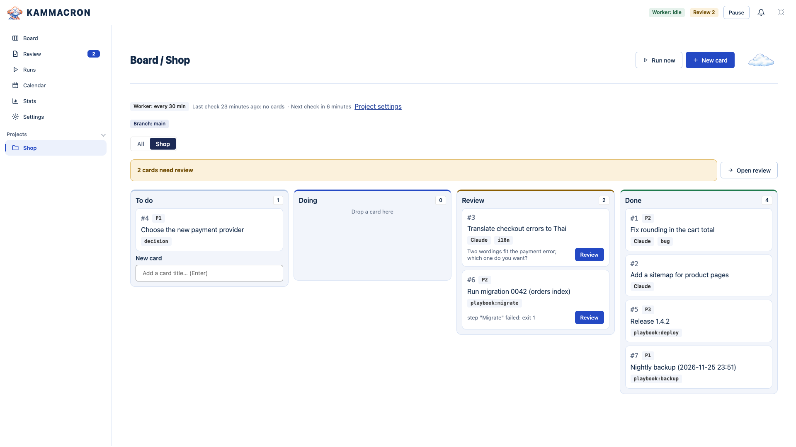

The board has four columns: **To do**, **Doing**, **Review** and **Done**. It shows one project, or all of them together, and updates live as the worker moves cards. Drag a card to move it, or focus it and use **Alt+arrow keys**. **New card** opens the full form; the line at the bottom of **To do** adds a card by its title and Enter.

## What a card carries

| Field       | What it does                                                                                                                     |
| ----------- | -------------------------------------------------------------------------------------------------------------------------------- |
| Title, body | The task, in Markdown. Paste or drop a screenshot into the body: the worker copies the card's images where Claude can open them. |
| Owner       | **Claude** adds the `claude` tag, so the worker may take the card. **Human** leaves it for a person.                             |
| Priority    | A number; higher is picked first.                                                                                                |
| Tags        | Any labels. `claude` is the one the worker looks for.                                                                            |
| Waits on    | Card numbers (`12, 14`). The card is not picked until every one of them is done.                                                 |
| Discussion  | Comments. Claude reads every comment on its next run, and writes its own when it finishes.                                       |

## Which cards Claude takes

On a project's round, a card is picked when it is in **To do**, tagged `claude`, not marked human, not archived, every card it waits on is done, and the project's worker is on. The highest priority goes first. Nothing is ever deleted: cards are archived.

A card Claude cannot finish alone comes back in one of three ways:

- moved to **Review** with a reason (Claude handed it over, a step of the playbook failed, it hit a limit);
- moved back to **To do** and marked human, with a question in a comment;
- split: Claude creates small `claude` cards for the parts it can do, makes this card wait on them, and marks this one human.

See [review](/guides/review/) for what to do with a card in Review.
