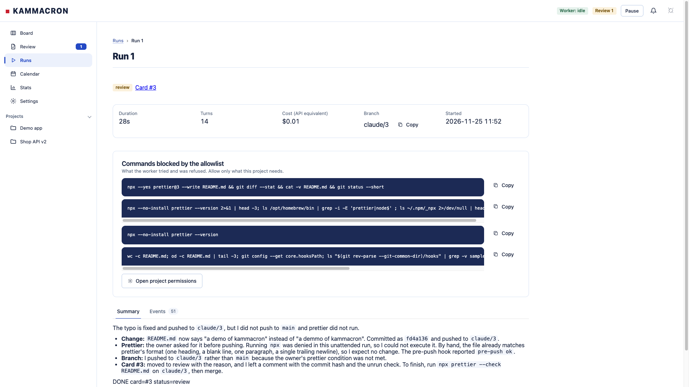

kammacron never runs Claude Code with `--dangerously-skip-permissions`. Every run gets an exact `--allowedTools` list and a `--disallowedTools` list; anything not allowed is refused, and the refusal is recorded on the run.

## Allowed in every run

- `Read`, `Edit`, `Write`, `Glob`, `Grep`;
- the kammacron MCP tools, and the project's **enabled MCP servers** (from the repository's `.mcp.json`);
- read-and-commit git: `status`, `diff`, `log`, `show`, `add`, `commit`, `fetch`, `rebase`, `restore`, `rev-parse`, `stash`, `merge-base`, `ls-files`, `blame`, `branch --show-current`;
- `git push origin HEAD:claude/<card>`, and `git push origin HEAD:<branch>` only with the `push` policy and no gate;
- the project's **allowed bash** commands, such as `Bash(bun run test:*)`;
- `WebSearch` and `WebFetch`, only with **web tools** on.

## Always refused

Force pushes (`--force`, `-f`, `--force-with-lease`), `--no-verify` on push or commit, `git commit -n`, `git reset --hard`, `git clean`, `git filter-branch`, `git branch -D`, `git config`, `git remote` and `git -c`.

## Commands blocked by the allowlist

Each run lists the commands Claude tried and was refused. Allow only what the project needs: **Open project permissions** goes straight to the list.

## After every run

kammacron reads the remote itself instead of trusting the run's account:

- a ref changed that the run may not push pauses the project;
- a card moved to Done without its commits on the branch goes to Review;
- with a gate or a verify command, see [shipping and review](/guides/shipping/).

A paused project shows the reason on its board and in the calendar. `kammacron pause` stops the worker everywhere, at once.
