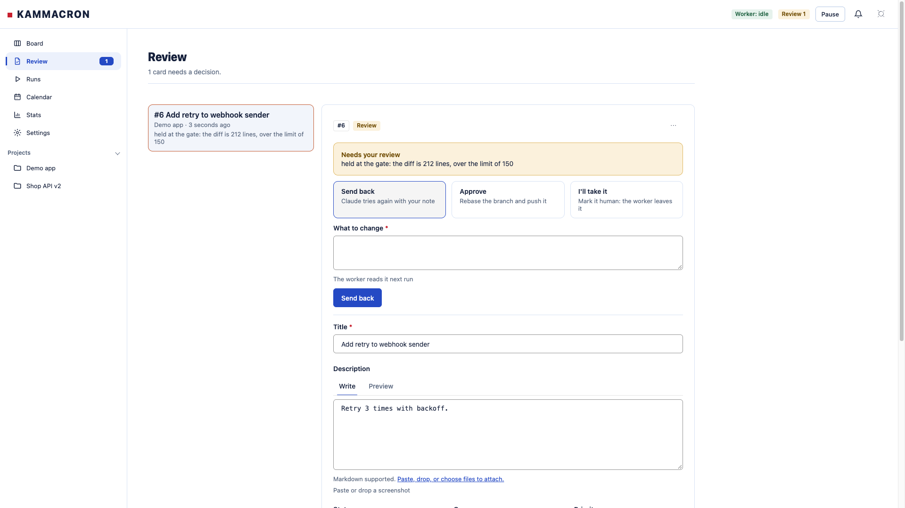
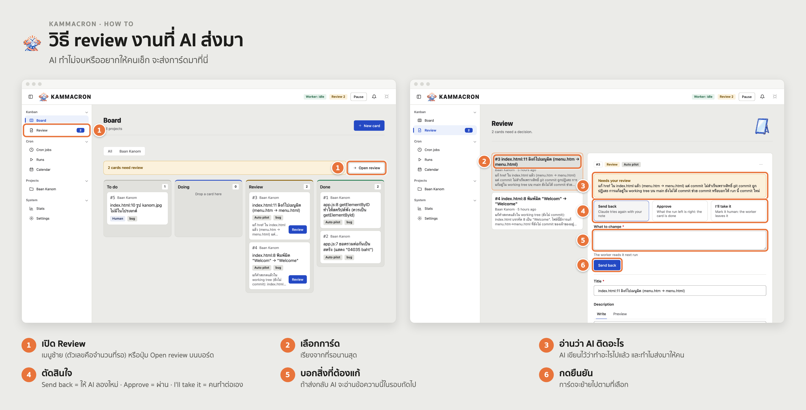

A card goes to **Review** when a person should decide:

- Claude moved it there, with a reason (it could not finish, it needs a decision);
- a step of the playbook failed: the reason names the step, and the end of its output is a comment on the card;
- the Claude step ended without moving the card, or hit its max turns;
- a run was stopped, or ran past the stale time, twice.

The **Review** page lists every such card with its reason and the latest run.

- **Send back**: Claude tries again with your note, which it reads on the next run (with the earlier runs' summaries).
- **Approve**: what the run left is right; the card is done. kammacron merges and pushes nothing: if the work waits on a branch, ship it your way, or send the card back saying how.
- **I'll take it**: marks the card human; the worker leaves it.
