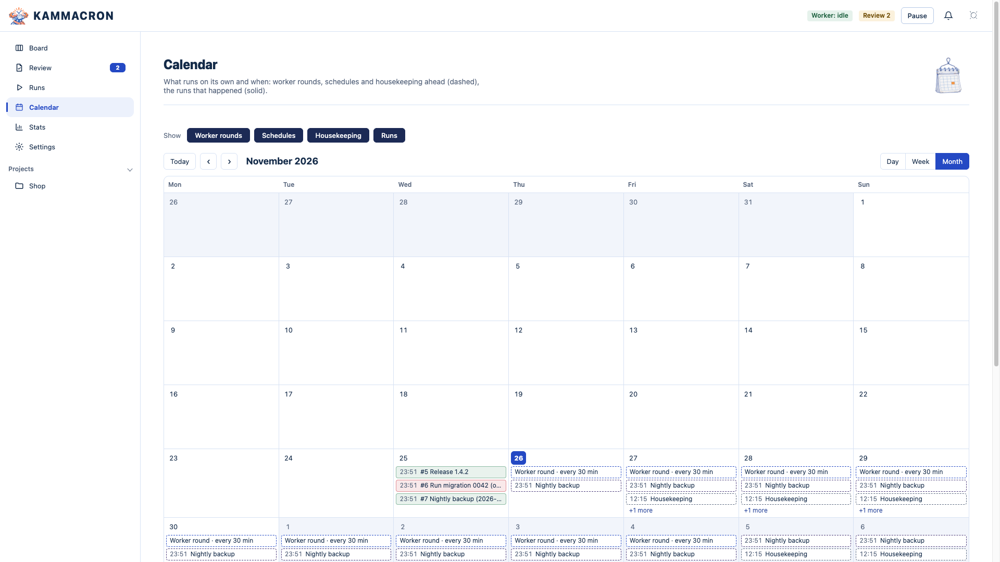

## Schedules

A schedule runs on an interval, inside the project's round, in the project's directory as it is. Add one under **Project settings → Schedules**: a name, what it **runs**, and how often (once a day by default). It runs one of two things.

**A command**, such as a health check (`curl -fsS --max-time 10 https://example.com/health`), tests or a backup. It passes on exit 0. When it fails, kammacron opens a card titled `<name> fails` with the output in a comment, and notifies you once (desktop or webhook; the output is not sent). While that card is open, later failures add a comment to it instead of opening another.

The card is yours. To have it worked automatically, set the schedule's **Tags of that card**, for example `claude`; Claude then reads the output as data, not as its task.

**A playbook** of the project, such as a nightly backup or a weekly deploy. Each time, kammacron opens a card titled with the schedule's name and the time, tagged `playbook:<name>`, and the same round runs it (schedules go before cards). The run, its steps and its result are on the board and in Runs like any other. While the last such card is still open (it failed and waits in Review, say), no new one is opened.

## The calendar

**Calendar** shows what runs on its own, and when:

- each project's **worker round**, its **schedules**, and the daily **housekeeping**, ahead, as dashed marks (a job that runs more often than every two hours shows as one line a day);
- the **runs** that happened, as solid blocks coloured by how they ended.

Day, week and month views; filter by layer or project. A click opens the run, the board or the project's schedules. Below, a table lists every job with its interval, next and last run, last result, and why it is off when it is (`worker off`, `paused: …`, `all work paused`).

Housekeeping removes run events older than the retention (30 days by default) and files no card uses any more.
