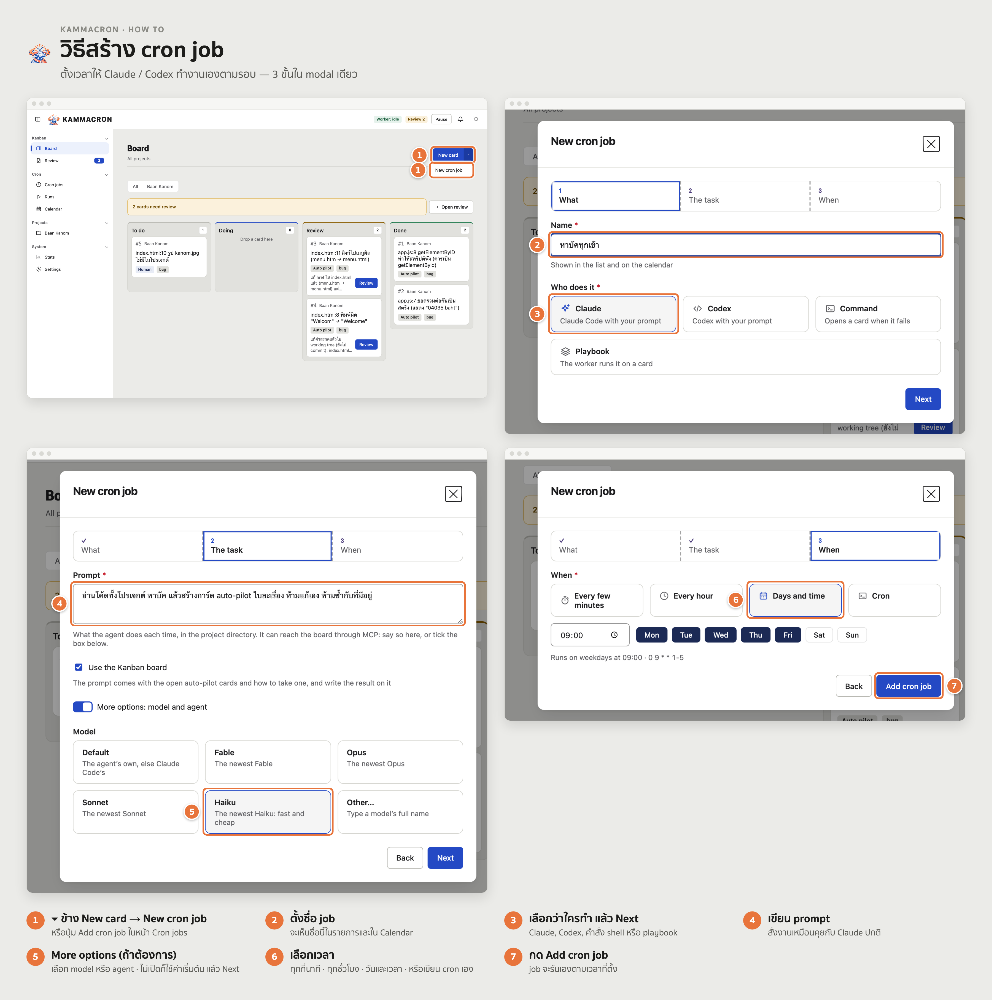
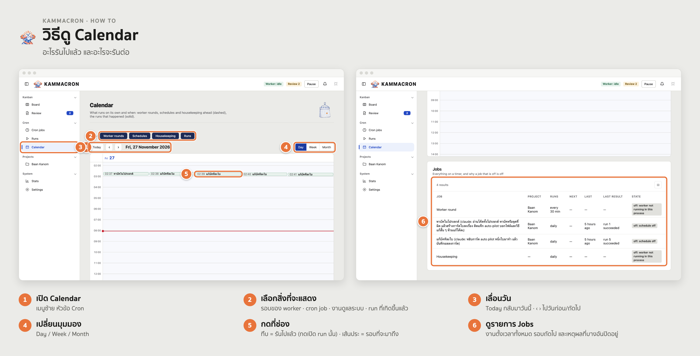

## Cron jobs

A cron job (a schedule) runs in the project's directory as it is, on its own time: the project's worker switch does not have to be on, only a directory set and the project not paused. Add one with **Add cron job** on the **Cron jobs** page (in the navigator, under Cron; with more than one project, pick it with the tabs at the top), with **New card ▾ → New cron job** on the board, or in a project's settings under **Schedules**. It takes three short steps:

1. **What**: the project (asked only on the board's all-projects view), the job's **name**, and **who does it**: Claude, Codex, a command or a playbook.
2. **The task**: the prompt (with **Use the Kanban board**), the command, or the playbook. Claude's agent and the model are folded under **More options**; left folded, the agent's own defaults apply.
3. **When**: the time, weekdays at 09:00 until you pick another.

### When

Set it the way an alarm clock is set, with one of four cards:

| Card              | What you set                                    | Saved as                           |
| ----------------- | ----------------------------------------------- | ---------------------------------- |
| Every few minutes | 5, 10, 15, 20 or 30 minutes                     | `*/15 * * * *`                     |
| Every hour        | the minute past the hour                        | `15 * * * *`                       |
| Days and time     | a time, and the days it runs (any of Mon … Sun) | `30 7 * * 2,4` (Tue and Thu 07:30) |
| Cron              | the five fields, one box each                   | as typed                           |

All seven days save as `*`, Monday to Friday as `1-5`. A sentence under the picker reads it back ("Runs on Tue and Thu at 07:30"). What is saved is always a cron expression.

**Cron** opens the five fields in five boxes (minute, hour, day of month, month, day of week), filled with what the card before it made: type them as a one-time code is typed (a space moves to the next box, Backspace in an empty one steps back), or paste a whole expression into any box. A box holding something its field does not take turns red. Times are the server's local time. Each box takes `*`, numbers, ranges (`1-5`), lists (`2,4`) and steps (`*/10`); a pasted `@hourly`, `@daily`, `@weekly` or `@monthly` is spelt out; day-of-week 0 and 7 are both Sunday. An expression that never comes (`0 0 31 2 *`) is refused.

### What it runs

**Claude or Codex, with your prompt.** The agent runs once in the project directory with the prompt you wrote, and the run (its steps, tool calls and summary) is on **Runs** like any other, named after the cron job. Both agents reach the board through kammacron's MCP with a token of their own, which can read and write the cards of this project only. So a prompt can ask for the board in its own words ("look at the open bugs and…").

Tick **Use the Kanban board** and the prompt also comes with the cards tagged `auto-pilot` that are open now (in To do, not a person's, waiting on nothing), and the rules for taking one: move it to doing first, comment the result, then move it to done, or to review with the reason. A card a run moved to doing and left there goes back to To do as a stale card would.

For example, tag cards `auto-pilot`, and add a cron job: **Codex**, **Hourly**, prompt "Take one auto-pilot card, do it, and write the result on the card." Each hour Codex reads the board, takes the best card, and leaves what it did on it.

- **Claude** runs as `claude -p`, with the project's allowed commands, MCP servers and model (or the job's own model), as a Claude step of a playbook does. While Claude is not signed in or is out of usage, its cron jobs wait an hour.
- **Codex** runs as `codex exec --json` in a `workspace-write` sandbox that never stops to ask, with the job's model or Codex's default. Sign in once with `codex` on this machine, as the user kammacron runs as. Set `KAMMACRON_CODEX_BIN` if it is not on the worker's PATH.

The **Claude** and **Codex** cards show only when this machine has that CLI (on the worker's PATH, or `KAMMACRON_CLAUDE_BIN` / `KAMMACRON_CODEX_BIN`).

**Agent** (Claude, under **More options**). When the project can call on Claude Code agents, pick one, and Claude runs as it: its instructions, its tools and its model, with your prompt as the task. kammacron finds them where Claude Code keeps them:

| Where                                   | Shows as          |
| --------------------------------------- | ----------------- |
| the project's `.claude/agents/*.md`     | its name          |
| your own `~/.claude/agents/*.md`        | its name          |
| the agents of the plugins you turned on | `<plugin>:<name>` |

A project's agent wins over one of yours with the same name. kammacron reads the agent's file each time and hands it to Claude (`--agents`, `--agent`), since Claude runs without the project's settings. An agent that names its `tools` keeps kammacron's MCP tools, so it can still reach the board. If the agent's file is gone when the job runs, the run fails and says so.

**Model** (under **More options**). **Default** leaves it to the agent: Claude takes the agent's `model`, else the project's, else Claude Code's; Codex takes its own. Claude's list is the aliases for the newest of each family (Fable, Opus, Sonnet, Haiku); Codex's is what Codex lists for your account (read from `~/.codex/models_cache.json`, so it appears once Codex has run here). **Other…** takes any model's full name.

**A command**, such as a health check (`curl -fsS --max-time 10 https://example.com/health`), tests or a backup. It passes on exit 0. When it fails, kammacron opens a card titled `<name> fails` with the output in a comment, and notifies you once (desktop or webhook; the output is not sent). While that card is open, later failures add a comment to it instead of opening another. The card is yours; to have agents work it, set the job's **Tags of that card** to `auto-pilot`. An agent reads the output as data, not as its task.

**A playbook** of the project, such as a nightly backup or a weekly deploy. Each time, kammacron opens a card titled with the job's name and the time, tagged `playbook:<name>`, and the worker runs it right after (when the project's worker is on). While the last such card is still open (it failed and waits in Review, say), no new one is opened.

### Usage limits

At the top of the Cron jobs page, a card for each agent this machine has shows how much of its usage windows is spent, the mark where spending at an even pace would be by now, and when each window starts over:

- **Claude**: the 5-hour and 7-day windows, as kammacron's last Claude run reported them (a cron job's or a card's). They are as fresh as that run; the card says which run and when.
- **Codex**: its 7-day window and your plan, from Codex's own session files on this machine, so your own Codex sessions count too.

Neither agent documents these numbers; when a new version writes them otherwise, the card says it has none rather than guess.

## The calendar

**Calendar** shows what runs on its own, and when:

- each project's **worker round**, its **cron jobs**, and the daily **housekeeping**, ahead, as dashed marks (a job that runs more often than every two hours shows as one line a day);
- the **runs** that happened, as solid blocks coloured by how they ended.

Day, week and month views; filter by layer or project. A click opens the run, the board or the project's schedules. Below, a table lists every job with its interval or cron expression, next and last run, last result, and why it is off when it is (`schedule off`, `paused: …`, `all work paused`).

Housekeeping removes run events older than the retention (30 days by default) and files no card uses any more.
