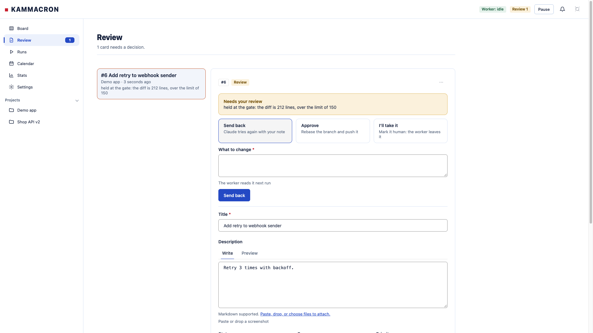

## Ship policy

| Policy           | What Claude does                                                                                                                                                                                                      |
| ---------------- | --------------------------------------------------------------------------------------------------------------------------------------------------------------------------------------------------------------------- |
| `push` (default) | Commits and runs `git push origin HEAD:<branch>`. The repository's pre-push hook is the gate: Claude fixes what it reports, at most twice; if it still fails, it pushes `claude/<card>` and moves the card to Review. |
| `branch`         | Never pushes to the branch. Commits, pushes `claude/<card>` and moves the card to Review: a person merges it.                                                                                                         |

`<branch>` is the default branch with a worktree, or the folder's branch without one. See [repo folder or worktree](/guides/working-copy/).

## The diff gate

Set **max diff lines** or **protected paths** (globs such as `migrations/**`) on a `push` project, and Claude pushes only `claude/<card>`. kammacron checks the diff itself: at most that many lines, and no file under a protected path. When it passes, kammacron rebases the branch and pushes it on, with an ordinary push, so the pre-push hook runs. When it does not, the card waits in Review with the reason, for example `held at the gate: the diff is 212 lines, over the limit of 150`.

## Verify and revert

With a **verify command** (a heavier check than pre-push, such as the full test suite), kammacron runs it on what reached the branch, twice for flaky tests. When it fails both times:

- if it also fails on the commit before the run, nothing is reverted and the project is paused: the branch was broken already;
- otherwise kammacron keeps the work on `claude/<card>`, reverts the run's commits with an ordinary push, comments the output on the card and sends it to Review.

If the revert itself cannot be pushed, the project is paused for a person.

## The Review page

Every card waiting for you, with its reason. For a card with a branch, the diff of `claude/<card>` against the branch it ships to.

- **Send back**: Claude tries again with your note, which it reads on the next run.
- **Approve**: kammacron rebases `claude/<card>` onto the branch and pushes it (an ordinary push; a conflict or a refused push leaves the card in Review with the error). A card with no branch, such as a question, is simply done.
- **I'll take it**: marks the card human; the worker leaves it.
