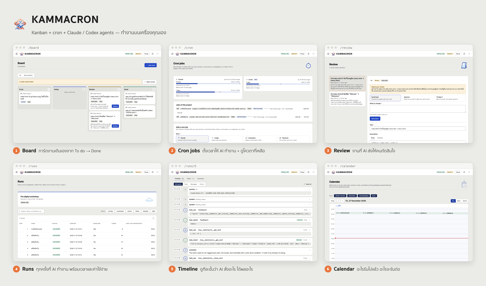

import { Card, CardGrid } from '@astrojs/starlight/components'

import HowItWorks from '../../components/HowItWorks.astro'

```sh
bunx kammacron start          # http://127.0.0.1:7420
```

<HowItWorks />



<CardGrid>
  <Card title="Cron jobs, in a GUI" icon="seti:clock">
    Every N minutes, hourly, daily, weekdays, weekly, or a cron expression you type. Each job runs
    Claude or Codex with your prompt, a command, or a playbook.
  </Card>
  <Card title="A board agents can work" icon="seti:todo">
    Tag a card `auto pilot` and an agent may take it. Through MCP it reads the board, moves the
    card, and writes what it did on it. Tick **Use the Kanban board**, or say so in the prompt.
  </Card>
  <Card title="Any command" icon="seti:shell">
    Ping a server, run tests, back up a database. A failure opens a card and notifies you; while it
    is open, later failures are added to it.
  </Card>
  <Card title="A playbook per project" icon="list-format">
    Steps in order, in the project's directory: tests, `ssh` to a server, a deploy, a migration. A
    step that fails stops the rest and sends the card to Review.
  </Card>
  <Card title="You decide" icon="comment-alt">
    What failed or was handed over waits with its reason and output. Approve it, send it back with a
    note, or take it yourself.
  </Card>
  <Card title="Claude or Codex, with your login" icon="puzzle">
    `claude -p` and `codex exec` run with the logins you already have; kammacron keeps none. Claude
    gets a tool allowlist, Codex a sandbox that writes only the project's directory.
  </Card>
  <Card title="Every run, on the record" icon="document">
    Each step and how it ended, its output, and a calendar of what runs when.
  </Card>
  <Card title="Your machine" icon="laptop">
    One process, PGlite by default or Postgres. A CLI and a background service. A board over MCP for
    agents that want it.
  </Card>
</CardGrid>
