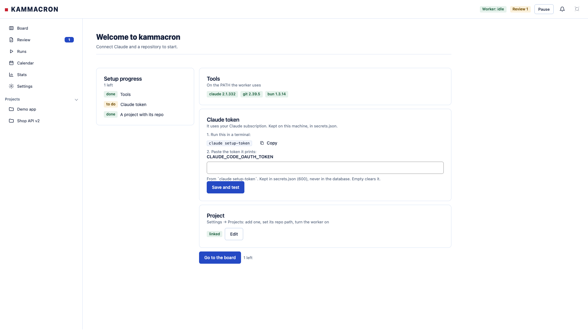

import { Steps, Aside } from '@astrojs/starlight/components'

<Steps>

1. **Claude token.** Run `claude setup-token` in a terminal and paste what it prints into **Settings → Claude connection** (or set `CLAUDE_CODE_OAUTH_TOKEN`). **Test** runs one short `claude -p`. The token is kept in `secrets.json` (mode 600), never in the database.

2. **Project.** **Settings → Projects → Add project**, give it a slug and a name, then set its **directory** and turn **Claude works this project** on. **Check the directory** says what it found there. Its **Playbook** is one Claude step until you add more.

3. **First card.** On the board, **New card**: a title, what you want in the body, owner **Claude**. Claude cards carry the `claude` tag, and the worker takes them on the project's next round. **Run now** starts a round straight away.

</Steps>

<Aside>
  Project rules for the worker can live in the repository at `.claude-worker/prompt.md`, and in
  **Extra rules** in the project's settings. Claude Code also reads the repository's own
  `CLAUDE.md`.
</Aside>

To add cards from Claude Code instead, see [Claude Code and MCP](/guides/mcp/).
