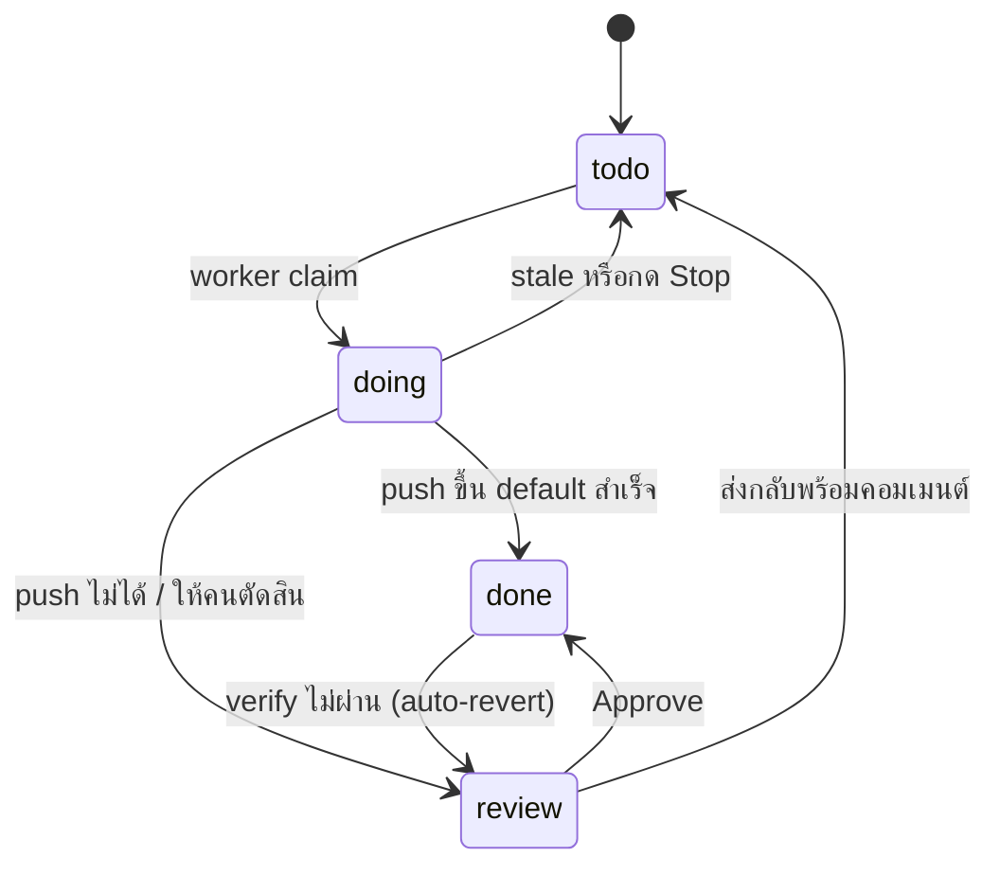

# Spec: kammacron — Kanban + MCP + Claude worker แบบ self-hosted

Nov 25, 2026 · @bank20baht

## สรุป

kammacron คือเว็บแอปบน localhost ที่รวม Kanban, MCP server และ worker ที่เรียก `claude -p` ไว้ใน process เดียว เป้าหมายคือให้ Claude แก้บัคเล็กๆ แล้ว push ขึ้น default branch เองโดยไม่ต้องรอคน คนเข้ามาเฉพาะการ์ดที่ต้องตัดสินใจจริง

การตัดสินใจหลักจากการสัมภาษณ์:

| เรื่อง             | ตัดสินใจ                                                                                 |
| ---------------- | -------------------------------------------------------------------------------------- |
| ผู้ใช้              | หนึ่งคนต่อหนึ่งการติดตั้ง ใช้ผ่านเบราว์เซอร์บน localhost ทุก OS เปิดจากเครื่องอื่นได้ด้วย tunnel ที่ผู้ใช้ต่อเอง |
| Process          | ตัวเดียว รวม web, API, MCP, ตัวตั้งเวลา และ worker                                          |
| DB               | PGlite อย่างเดียวในเฟสแรก `DATABASE_URL` ไป Postgres จริงค่อยเพิ่มทีหลัง                       |
| Auth ของ MCP     | Bearer token ยาวๆ ที่ระบบสร้างให้ ไม่ใช้ OAuth                                               |
| Token ของ Claude | `CLAUDE_CODE_OAUTH_TOKEN` ตัวเดียว ใช้ทุกโปรเจกต์                                           |
| โปรเจกต์          | ป้ายแบบ Kanzo จะผูก git repo หรือไม่ก็ได้ worker ทำเฉพาะโปรเจกต์ที่ผูก repo                      |
| การแยกงาน        | worktree ถาวรหนึ่งอันต่อโปรเจกต์ที่ `.worktrees/claude`                                       |
| การส่งงาน         | Claude commit แล้ว push ไป `origin/<default>` เอง โดยมี pre-push ของ repo เป็นด่านตรวจ     |
| Review           | เหลือเฉพาะงานที่ push ไม่ได้ หรืองานที่ Claude ส่งมาให้คนตัดสิน                                    |
| การแจก           | npm package ที่รันด้วย Bun                                                                 |

## จุดยืนเทียบกับเครื่องมืออื่น

kammacron คือตัวที่ปล่อยรันข้ามคืนได้อย่างปลอดภัย ด้วยโควต้า subscription ที่มีอยู่ Kanban + MCP + cron ที่เรียก Claude มีคนทำแล้วอย่างน้อย 2 ตัว จึงไม่ใช่จุดขาย ข้อมูลด้านล่างมาจาก README ของแต่ละตัว ยังไม่ได้ลองรันจริง

| เครื่องมือ                                                  | ลักษณะ                                                                                                   | ต่างจาก kammacron                                                              |
| -------------------------------------------------------- | ------------------------------------------------------------------------------------------------------- | ----------------------------------------------------------------------------- |
| [prodboard](https://github.com/G4brym/prodboard)         | Bun + SQLite, MCP, CLI, cron daemon ที่สั่ง Claude ด้วย prompt อิสระต่อ schedule, worktree ต่อ run, ดูสดผ่าน tmux | ใช้ `--dangerously-skip-permissions` และ API key เรียก agent ทุกรอบไม่ว่ามีงานหรือไม่ |
| [vibeboard](https://github.com/zanuartri/vibeboard)      | npm package, Node + SQLite, ย้ายการ์ดไป In Progress แล้วเปิด agent, worktree ต่อการ์ด, รีวิว diff แล้ว Merge/PR  | สั่งงานด้วยมือ ไม่มีตัวตั้งเวลา และข้ามการขอสิทธิ์                                         |
| [agentforge](https://github.com/hetaoBackend/agentforge) | แอปเดสก์ท็อป macOS, ตั้งเวลา task, output สด, Skill Library, แชต Telegram/Slack/Feishu, DAG                 | ศูนย์สั่งงาน agent ทั่วไป ไม่ได้เน้นแก้บัคใน repo ใช้ได้เฉพาะ macOS                        |
| [agentflow](https://github.com/UrRhb/agentflow)          | ใช้ Asana เป็นบอร์ด, cron sweep, แยกบท builder/reviewer/tester, เพดาน cost, revert เองเมื่อ `main` พัง        | ไม่มีบอร์ดของตัวเอง ต้องพึ่ง Asana                                                   |
| [taskter](https://github.com/tomatyss/taskter)           | Kanban บน terminal (Rust) มี agent runtime ของตัวเองที่เรียก API ของ Gemini/OpenAI                           | ไม่ได้ใช้ Claude Code เกี่ยวข้องน้อย                                                 |

**จุดต่างที่ต้องรักษา**

- **ปล่อยรันได้โดยไม่ข้ามการขอสิทธิ์** มี allowlist + denylist, ห้าม `--no-verify`, ใช้ pre-push เป็นด่านตรวจ และมี auto-revert
- **ประหยัดโควต้า** ใช้ token ของ subscription และ pre-check ที่ไม่เรียก Claude เลยถ้าไม่มีการ์ด
- **คัดงานก่อนให้ Claude ทำ** กติกา `claude`/`human`, การแตกการ์ด, `waits_on` และ review เฉพาะงานที่มีปัญหา ตัวอื่นส่งทุกงานเข้า PR หรือ review
- **ติดตั้งเป็น service ได้ทั้ง macOS และ Linux** พร้อมจำ PATH ไว้ให้

สิ่งที่ไม่ใช่จุดต่างแล้วเพราะคนอื่นมีกันหมด: ดู log สด, worktree, MCP แบบสองทาง และ dependency ระหว่างการ์ด

**สิ่งที่ยืมมา และไปอยู่เฟสไหน**

| ไอเดีย                                                  | มาจาก      | เฟส        |
| ------------------------------------------------------ | ---------- | ---------- |
| revert เองเมื่อ `main` พังหลัง push                        | agentflow  | 1          |
| schedule ที่สร้างการ์ด (เช่น รัน test ทุกคืนแล้วเปิดการ์ดให้ตัวที่ล้ม) | prodboard  | 2          |
| แจ้งเตือนผ่าน Telegram/Slack เมื่อมีการ์ดเข้า review           | agentforge | 2          |
| ปุ่มตั้งค่า MCP คลิกเดียว                                     | vibeboard  | 2          |
| เพดาน cost ต่อการ์ด                                      | agentflow  | ยังไม่ตัดสินใจ |
| กลั่นงานที่ทำซ้ำเป็น skill                                   | agentforge | 3          |

## ขอบเขต

เฟสแรกต้องใช้แทน Kanzo + `run.sh` + crontab-ui ได้ทั้งชุด และแก้ปัญหา 5 ข้อที่เจอจริง

**ในขอบเขต**

- Kanban: โปรเจกต์, การ์ด, แท็ก, คอมเมนต์, flag `human`, `waits_on`, priority และ archive
- รูปในการ์ดและคอมเมนต์: อัปโหลด, วาง (paste) หรือลากมาวาง แล้วแสดงใน markdown และ worker เห็นรูปด้วย
- REST API พร้อม MCP ที่สร้างจาก API อัตโนมัติ ตรวจสิทธิ์ด้วย bearer token
- ตัวตั้งเวลาต่อโปรเจกต์, pre-check, ปุ่ม Pause ทั้งระบบ และปุ่ม "รันตอนนี้"
- Worker: worktree ต่อโปรเจกต์, `claude -p` หนึ่งครั้งต่อการ์ด และอ่าน stream-json เป็น event สด
- หน้าเว็บ 4 หน้า: Board, Review inbox, Runs และ Settings
- npm package พร้อมคำสั่ง `start`, `open`, `status` และ `install-service` (launchd/systemd)

**นอกขอบเขต (เฟสแรก)**

- หลายผู้ใช้, ทีม, สิทธิ์ตามบทบาท และการรันบนเซิร์ฟเวอร์
- OAuth (ต้องใช้ถ้าจะต่อจาก claude.ai หรือ Claude Desktop)
- การ import จาก Kanzo
- ด่านตรวจขนาด diff และ path ที่ protected
- รันหลายการ์ดขนานกัน (concurrency มากกว่า 1)
- Dashboard สถิติ, export, การแจ้งเตือน และการอัปเดตตัวเอง
- Binary ที่ compile แล้ว และ service บน Windows
- Workflow อื่นนอกจากแก้โค้ด (เช่น งานวิจัยในโปรเจกต์ที่ไม่มี repo)

## สถาปัตยกรรม

ทุกอย่างรันใน Bun process เดียว ช่องทางเดียวที่แก้ข้อมูลคือ service layer ของ server เอง ทำให้ live update ใช้ `changed()` ได้โดยไม่ต้องพึ่ง LISTEN

- **Elysia server** bind `127.0.0.1:7420` (เปลี่ยนได้ด้วย `--host`/`--port` หรือ env) เสิร์ฟ 5 ส่วน:
  - `/api/*` REST + OpenAPI
  - `/mcp` MCP แบบ streamable HTTP
  - `/live/*` SSE ของ `@20baht/live`
  - `/files/:id` ไฟล์แนบ (ต้องผ่าน auth ดูหัวข้อไฟล์แนบ)
  - ไฟล์ static ของ Angular
- **Service layer** เป็นที่เดียวที่เขียน DB ทุกการเขียนเรียก `changed(topic)` เสมอ ทั้ง REST, MCP และ worker ใช้ชุดเดียวกัน
- **Scheduler** เป็น loop ใน process เดียวกัน (tick ทุก 30 วินาที) ดู `next_run_at` ของแต่ละโปรเจกต์ แล้วส่งงานเข้าคิว worker
- **Worker** เป็นคิวที่ทำทีละ 1 งาน spawn `claude -p` เป็น process ลูก อ่าน stdout ทีละบรรทัด
- **DB** คือ PGlite ที่ `~/.kammacron/db` ใช้ drizzle เป็น ORM และรัน migration ตอน start

**Auth**

- ตอนเริ่มครั้งแรกระบบสร้าง `api_token` (32 byte แบบสุ่ม) เก็บไว้ใน DB
- `/api` และ `/mcp` ต้องมี `Authorization: Bearer <token>` ตรวจแบบ constant-time
- หน้าเว็บได้ session cookie (HttpOnly, SameSite=Strict) ตอนเปิดจาก loopback ถ้าเข้ามาจาก host อื่น (ผ่าน tunnel) ต้องใส่ token ครั้งแรกก่อน
- ทุก request ตรวจ `Host` และ `Origin` กับ allowlist (ค่าเริ่มต้นคือ `localhost`/`127.0.0.1` เพิ่ม host ของ tunnel ได้ใน Settings) เพื่อกัน DNS rebinding และ CSRF
- หน้า Settings มีปุ่ม rotate token และคำสั่ง `claude mcp add --transport http kammacron http://127.0.0.1:7420/mcp --header "Authorization: Bearer …"` ที่ copy ได้ทันที

คำถามที่ยังเปิดอยู่: ควรแยก token ของ worker ออกจาก `api_token` หรือไม่ ตอนนี้ token ตัวเดียวเรียก endpoint ควบคุม (pause, approve, settings) ได้ด้วย ที่กันไว้มีแค่การไม่สร้าง tool ให้ MCP แต่ worker มี token จริงอยู่ในไฟล์ `--mcp-config` และ tool `Read` ไม่ได้จำกัดอยู่ใน worktree ถ้าโปรเจกต์ไหนเปิด `WebFetch` หรือ `curl` ใน `allowed_bash` worker จะเรียก endpoint เหล่านั้นได้ ทางแก้ที่เสนอคือ token แยกของ worker ที่ server รับเฉพาะ route ที่ MCP ใช้

## Data model

มี 8 ตาราง ทุกตารางมี `created_at` และ `updated_at` id ของการ์ดเป็นเลขรันต่อเนื่อง (`#12`) ให้คนและ Claude อ้างถึงได้ง่าย

| ตาราง                | คอลัมน์หลัก                                                                                                                                                                                                                                                                                                                                                      |
| -------------------- | ------------------------------------------------------------------------------------------------------------------------------------------------------------------------------------------------------------------------------------------------------------------------------------------------------------------------------------------------------------- |
| `settings` (แถวเดียว) | `api_token_hash`, `paused`, `stale_minutes` (60), `run_log_retention_days` (30), `allowed_hosts[]`                                                                                                                                                                                                                                                            |
| `projects`           | `id`, `slug`, `name`, `repo_path?`, `default_branch?` (หาเองจาก `origin/HEAD`), `worker_enabled`, `interval_minutes` (30), `next_run_at`, `last_checked_at?`, `last_check_result?`, `max_cards_per_run` (3), `max_turns`, `model`, `extra_prompt`, `allowed_bash[]`, `copy_files[]`, `setup_command?`, `verify_command?`, `enabled_mcp_servers[]`, `archived` |
| `cards`              | `id` (serial), `project_id`, `title`, `body` (markdown), `status` (todo/doing/review/done), `tags[]`, `human` (bool), `priority` (int), `position` (ลำดับในคอลัมน์), `review_reason?`, `branch?`, `stale_count`, `claimed_by_run?`, `archived`                                                                                                                   |
| `card_waits_on`      | `card_id`, `waits_on_id` (PK คู่, ตรวจไม่ให้เกิด cycle ตอนเขียน)                                                                                                                                                                                                                                                                                                    |
| `comments`           | `id`, `card_id`, `author` (`user` / `claude-worker` / `mcp`), `run_id?`, `body`                                                                                                                                                                                                                                                                               |
| `runs`               | `id`, `project_id`, `card_id`, `status` (running/verifying/succeeded/review/failed/stopped/stale/reverted), `started_at`, `ended_at`, `num_turns`, `cost_usd`, `usage` (jsonb), `session_id`, `commits[]`, `pushed_to?`, `revert_commit?`, `exit_code`, `error?`, `log_path`                                                                                  |
| `run_events`         | `id`, `run_id`, `seq`, `type` (assistant/tool_use/tool_result/system/result), `summary` (ตัดให้สั้น), `data` (jsonb ตัดที่ 8 KB)                                                                                                                                                                                                                                     |
| `attachments`        | `id` (uuid), `card_id?`, `sha256`, `mime`, `size`, `filename`, `uploaded_by` (`user` / `mcp`)                                                                                                                                                                                                                                                                 |

รอบที่ pre-check ไม่เจอการ์ดจะไม่สร้างแถวใน `runs` แต่จะอัปเดต `projects.last_checked_at` และ `last_check_result` แทน หน้าเว็บจะได้แสดงว่า "เช็กล่าสุด 09:30 — ไม่มีการ์ด" ให้เห็นว่าระบบยังทำงานอยู่

คอลัมน์ของ auto-revert คือ `projects.verify_command?` (ว่างเท่ากับปิด), ค่า `verifying` และ `reverted` ใน `runs.status` และ `runs.revert_commit?`

คำถามที่ยังเปิดอยู่: จะใช้ `@20baht/runs` เก็บตาราง `runs` แทนการเขียนตารางเองดีไหม (ดูหัวข้อไลบรารี 20baht)

## ไฟล์แนบ

บัคส่วนใหญ่มาพร้อมภาพหน้าจอ รูปจึงต้องใช้ได้ทั้งคนและ Claude ตั้งแต่เฟสแรก

**ที่เก็บ**

- ตัวไฟล์อยู่ที่ `~/.kammacron/files/<sha256>.<ext>` ไม่เก็บใน PGlite จะได้ไม่ทำให้ DB บวมและ backup ช้า ตั้งชื่อตาม hash ไฟล์ซ้ำจึงเก็บแค่ชุดเดียว
- metadata อยู่ในตาราง `attachments` markdown อ้างถึงด้วย ``
- การ์ดอ้างถึงไฟล์ผ่าน `card_id` ตั้งค่าตอนบันทึกการ์ดหรือคอมเมนต์ที่มีลิงก์ `/files/<id>` ไฟล์ที่ไม่มีการ์ดไหนอ้างถึงเกิน 1 วันจะถูกลบ (กรณีวางรูปแล้วไม่ได้บันทึก)

**อัปโหลด**

- หน้าเว็บ: `POST /api/files` แบบ multipart ใน editor ของการ์ดและคอมเมนต์ วางหรือลากรูปมาวางแล้วระบบใส่ `` ให้เอง
- MCP: `POST /api/files:base64` รับ JSON `{ filename, mime, data }` เพราะ MCP ส่ง multipart ไม่สะดวก

**ความปลอดภัย**

- `/files/:id` ต้องผ่าน auth เหมือน `/api` (session cookie หรือ bearer)
- รับเฉพาะ `image/png`, `image/jpeg`, `image/gif` และ `image/webp` ตรวจจาก magic bytes ไม่เชื่อ `Content-Type` ที่ส่งมา ไม่รับ SVG เพราะรัน script ได้
- ส่งกลับด้วย `Content-Type` ที่ตรวจไว้, `X-Content-Type-Options: nosniff` และ `Content-Security-Policy: sandbox`
- จำกัดไฟล์ละ 10 MB

**ให้ worker เห็นรูป**

- ก่อน spawn `claude -p` โปรแกรม copy รูปของการ์ดใบนั้นไปที่ `<worktree>/.kammacron/attachments/` (อยู่ใน `.git/info/exclude` จึงไม่ถูก commit และ `git clean -fd` ไม่ลบ) แล้วเขียน path ลงใน prompt
- Claude ใช้ tool `Read` เปิดรูปเองได้ เพราะ `Read` อ่านรูปได้อยู่แล้ว ไม่ต้องขยายสิทธิ์อ่านออกนอก worktree
- `GET /cards/{id}` ส่งรายการไฟล์แนบ (id, ชื่อ, mime, ขนาด) กลับไปด้วย

## วงจรชีวิตของการ์ด

การ์ดมี 4 สถานะ `todo` → `doing` → `review` → `done` การ์ดที่ไม่มีแท็ก `claude` คนลากย้ายได้อิสระ ส่วนการ์ด `claude` เดินตามแผนภาพนี้ (4 สถานะ, 7 ทาง)



**worker หยิบการ์ดได้เมื่อครบทุกข้อ**

- มีแท็ก `claude` และไม่มี flag `human`
- สถานะเป็น `todo` และไม่ได้ archive
- การ์ดทุกใบใน `waits_on` อยู่ `done` แล้ว
- โปรเจกต์ผูก repo เปิด worker ไว้ และระบบไม่ได้ pause

เรียงตาม `priority` มากไปน้อย แล้วตาม `created_at` เก่าไปใหม่

**กติกาของแต่ละทาง**

- **`todo → doing`** โปรแกรมเป็นคนย้ายตอน claim ด้วย `UPDATE … WHERE status = 'todo'` ใน transaction เดียว พร้อมตั้ง `claimed_by_run`
- **`doing → done`** Claude push สำเร็จ แล้วเขียนคอมเมนต์สรุปพร้อม commit hash หลังจบ run โปรแกรมตรวจซ้ำว่า commit อยู่บน `origin/<default>` จริง
- **`doing → review`** เกิดเมื่อ push ไม่ผ่าน pre-push, rebase ชน หรือ Claude เห็นว่าต้องให้คนตัดสิน Claude push งานไป `claude/<card-id>` และต้องใส่ `review_reason` ถ้า run จบโดยการ์ดยังอยู่ `doing` โปรแกรมย้ายไป `review` พร้อมเหตุผล "run จบโดยไม่สรุปผล"
- **`doing → todo`** ค้างเกิน `stale_minutes` หรือกด Stop โปรแกรม kill process แล้วเพิ่ม `stale_count` ถ้าครบ 2 ครั้งจะไป `review` แทน
- **`review → done` (Approve)** โปรแกรม rebase branch `claude/<card-id>` แล้ว push ไป default branch ถ้าชนหรือ pre-push ไม่ผ่าน การ์ดยังอยู่ `review` พร้อมแสดง error
- **`review → todo` (ส่งกลับ)** ต้องพิมพ์คอมเมนต์ worker รอบหน้าได้คอมเมนต์ทั้งหมดใน prompt และทำต่อจาก branch เดิมถ้ามี
- **`done → review` (auto-revert)** ถ้า verify หลัง push ไม่ผ่าน โปรแกรมจะ revert แล้วย้ายการ์ดกลับมา review รายละเอียดอยู่ในหัวข้อวงจรชีวิตของ run
- **รับไปทำเอง** ใส่ flag `human` สถานะไม่เปลี่ยน
- **Claude พบว่าเป็นงานของคน** ใส่ flag `human` แตกส่วนที่ทำเองได้เป็นการ์ด `claude` ใบเล็ก (ใบใหญ่ `waits_on` ใบเล็กได้) แล้วคืนการ์ดไป `todo`

## วงจรชีวิตของ run และ worker

การ์ดหนึ่งใบเท่ากับ `claude -p` หนึ่งครั้ง และเท่ากับหนึ่งแถวใน `runs` ทั้งเครื่องรันทีละการ์ด (concurrency = 1)

**หนึ่งรอบของโปรเจกต์**

1. ถึง `next_run_at` หรือกด "รันตอนนี้" ถ้าระบบ pause อยู่ให้ข้าม
2. เก็บกวาดการ์ดที่ค้างอยู่ `doing` เกิน `stale_minutes` (กรณี process ตายหรือแอปถูกปิดกลางคัน)
3. pre-check ด้วย query เดียว ถ้าไม่มีการ์ดที่หยิบได้ ให้บันทึก `last_check_result` แล้วจบรอบโดยไม่เรียก `claude`
4. เตรียม worktree (ดูหัวข้อถัดไป) แล้ว claim การ์ดใบแรก
5. spawn `claude -p` ด้วย `cwd` = worktree และอ่าน stream-json
6. จบ run แล้วตรวจผล (การ์ดอยู่สถานะไหน, commit อยู่บน remote ไหม) บันทึกผลลง `runs`
7. ทำซ้ำจากข้อ 3 จนครบ `max_cards_per_run` แล้วตั้ง `next_run_at` ใหม่

**Worktree**

- สร้างครั้งแรกที่ `<repo>/.worktrees/claude` แบบ detached และใส่ `.worktrees/` กับ `.kammacron/` ลง `.git/info/exclude` ให้เอง
- copy ไฟล์ใน `copy_files` (ค่าเริ่มต้น `.mcp.json`, `.claude/settings.local.json`) แล้วรัน `setup_command` ครั้งเดียว
- ก่อนทำการ์ดทุกใบ: `git fetch origin` → `git checkout -B claude/<card-id> origin/<default>` → `git clean -fd` (ไม่ลบไฟล์ที่ ignore เช่น `node_modules`) ถ้าการ์ดถูกส่งกลับและมี branch เดิม ให้ checkout branch นั้นแทน
- ถ้าไฟล์ lock ของ dependency เปลี่ยนจากรอบก่อน ให้รัน `setup_command` ซ้ำ

**คำสั่งที่ worker เรียก (โครงคร่าว)**

```
claude -p "<prompt>" \
  --output-format stream-json --verbose \
  --model <model> --max-turns <max_turns> \
  --allowedTools <allowlist> --disallowedTools <denylist> \
  --mcp-config <app-data>/mcp/<project>.json \
  --append-system-prompt "<กติกากลาง + extra_prompt>"
```

- env มี `CLAUDE_CODE_OAUTH_TOKEN` และ PATH ที่บันทึกไว้
- `--mcp-config` มี kammacron (URL + token) รวมกับ MCP ของโปรเจกต์ที่เปิดใช้ใน `enabled_mcp_servers`
- prompt ประกอบด้วย เนื้อหาการ์ด, คอมเมนต์ทั้งหมด, path ของรูปที่แนบ (ดูหัวข้อไฟล์แนบ), สรุป run ก่อนหน้าของการ์ดใบนี้ และชื่อ default branch

**ดูสดและหยุด**

- ทุกบรรทัดของ stream-json ถูกเขียนลงไฟล์ log ดิบ และแปลงเป็น `run_events` แบบย่อ จากนั้นเรียก `changed('run:<id>')`
- event `result` ให้ `num_turns`, `total_cost_usd`, `usage` และ `session_id`
- ปุ่ม Stop ส่ง SIGTERM รอ 10 วินาที แล้วตามด้วย SIGKILL จากนั้นคืนการ์ดไป `todo`
- เมื่อแอป start ใหม่ run ที่ค้างสถานะ `running` จะถูกตั้งเป็น `stale` และการ์ดกลับไป `todo`

**ตรวจหลัง push และ revert อัตโนมัติ**

pre-push ตรวจก่อน push ส่วน auto-revert ตรวจ commit ที่ขึ้น default branch ไปแล้วด้วยชุดที่หนักกว่า เป็นงานของโปรแกรมทั้งหมด Claude ไม่ได้เกี่ยว

1. เปิดเมื่อโปรเจกต์ตั้ง `verify_command` เช่นชุด test เต็ม ถ้าว่างจะไม่มีการตรวจนี้
2. หลัง run ที่ push ขึ้น default branch สำเร็จ run เป็น `verifying` โปรแกรม checkout commit นั้นใน worktree แล้วรัน `verify_command` ถ้าไม่ผ่านให้รันซ้ำอีก 1 ครั้งกัน test ที่ flaky
3. ถ้ายังไม่ผ่าน ให้รัน `git revert --no-edit <commits ของ run>` บน `origin/<default>` ล่าสุด แล้ว push ตามปกติ (ไม่ force และผ่าน pre-push) ข้อความ commit อ้างเลขการ์ดและ run
4. run เป็น `reverted` การ์ดไป `review` พร้อมเหตุผลและ output ส่วนท้ายของ verify งานเดิมยังอยู่ที่ `claude/<card-id>` กด "ส่งกลับ" แล้ว Claude จะแก้ต่อจากตรงนั้น
5. ถ้า revert แล้ว push ไม่ได้ (มี commit ใหม่เข้ามาชน) หรือ `main` พังมาตั้งแต่ก่อน run นี้ โปรแกรมจะ pause worker ของโปรเจกต์และแจ้งเตือน ไม่พยายามแก้เอง

ระหว่าง verify worker จะไม่หยิบการ์ดถัดไปของโปรเจกต์เดียวกัน เพื่อไม่ให้งานใหม่ซ้อนบน commit ที่ยังไม่รู้ผล เวลาที่ใช้ verify มี timeout แยก ค่าเริ่มต้น 15 นาที

## ความปลอดภัยของ worker

Worker ไม่ใช้ `--dangerously-skip-permissions` ใช้ allowlist คู่กับ denylist และให้ pre-push hook ของ repo เป็นด่านตรวจคุณภาพ worktree ใช้ hooks ชุดเดียวกับ repo หลักอยู่แล้ว

| กลุ่ม             | อนุญาต (allowlist)                                                                                                              | ห้าม (denylist)                                                                                               |
| --------------- | ------------------------------------------------------------------------------------------------------------------------------ | ------------------------------------------------------------------------------------------------------------ |
| ไฟล์             | `Read`, `Edit`, `Write`, `Glob`, `Grep`                                                                                        | —                                                                                                            |
| Bash ของโปรเจกต์ | ตาม `allowed_bash` เช่น `Bash(bun test:*)`, `Bash(bun run lint:*)`                                                              | —                                                                                                            |
| git             | `status`, `diff`, `log`, `show`, `add`, `commit`, `fetch`, `rebase`, `push origin HEAD:<default>`, `push origin HEAD:claude/*` | `push --force`, `push -f`, refspec ที่ขึ้นต้น `+`, `--no-verify`, `branch -D`, `reset --hard`, `config`, `remote` |
| MCP             | kammacron + MCP ของโปรเจกต์ที่เปิดไว้                                                                                               | MCP อื่น                                                                                                       |
| เครือข่าย         | `WebSearch`, `WebFetch` เปิดได้ต่อโปรเจกต์ (ค่าเริ่มต้นปิด)                                                                             | —                                                                                                            |

**กติกากลางที่ใส่ใน system prompt**

- ทำงานเฉพาะใน worktree นี้ และเฉพาะการ์ดที่ได้รับ
- ก่อนแก้ ให้ประเมินว่าเป็นงาน `claude` จริงไหม (ย้อนกลับได้, อยู่ใน repo, มีเงื่อนไขเสร็จชัด) ถ้าแตะเรื่อง security, data/migration, release/deploy, breaking API, เงิน หรือการตัดสินใจเชิง product ให้ส่ง review หรือใส่ `human`
- ห้ามแก้ hook, config ของ CI หรือไฟล์ใน `.claude/` เพื่อให้ผ่านด่านตรวจ
- ถ้า pre-push ไม่ผ่าน ให้แก้ได้ไม่เกิน 2 ครั้ง จากนั้น push ไป `claude/<card-id>` แล้วส่ง review
- จบทุกครั้งด้วยการย้ายการ์ดและเขียนคอมเมนต์สรุป

**สิ่งที่โปรแกรมทำเอง ไม่พึ่ง prompt**

- หลังจบ run ตรวจว่ามีการ push ไป branch อื่นนอกจาก default และ `claude/*` หรือเปล่า ถ้ามี ให้แจ้งเตือนและ pause โปรเจกต์นั้น
- ปุ่ม Pause ทั้งระบบ และคำสั่ง `kammacron pause` จาก terminal
- จำกัดเวลาต่อ run ด้วย `stale_minutes` และจำกัดจำนวน turn ด้วย `--max-turns`

**Token**

- `CLAUDE_CODE_OAUTH_TOKEN` ที่ได้จาก `claude setup-token` ใช้โควต้า subscription ไม่ใช่ API
- ถ้ามี env var นี้อยู่แล้วใช้ค่าจาก env ถ้าไม่มีให้ใส่ผ่าน Settings เก็บไว้ที่ `~/.kammacron/secrets.json` สิทธิ์ 600 ไม่เก็บใน DB
- หน้าเว็บแสดงแค่ 4 ตัวท้าย และมีปุ่ม "ทดสอบ" ที่เรียก `claude -p` สั้นๆ หนึ่งครั้ง
- ส่งให้เฉพาะ env ของ process ลูก และตัดออกจาก log ทุกที่
- `api_token` ของ MCP เก็บเป็น hash ใน DB ส่วนตัวจริงเก็บใน `secrets.json` เพราะต้องเอาไปใส่ใน `--mcp-config` ของ worker และแสดงในคำสั่ง `claude mcp add`

## MCP

MCP สร้างจาก OpenAPI ของ `/api` ด้วย `@20baht/elysia-openapi-mcp` tool จึงเท่ากับ endpoint ที่เปิดให้ MCP รายชื่อสุดท้ายให้เทียบกับไลบรารีจริงอีกครั้ง

**ข้อบังคับ**

- ไม่มีการลบผ่าน MCP ทำได้แค่ archive endpoint ที่ลบจริงต้องติดป้ายให้ไม่ถูกสร้างเป็น tool
- endpoint ที่ใช้ควบคุม worker ไม่เปิดให้ MCP ได้แก่ pause, แก้ settings ของโปรเจกต์, approve และ rotate token เพื่อไม่ให้ Claude ขยายสิทธิ์ตัวเองหรือ approve งานตัวเอง
- กติกาสร้างการ์ด (ประเมิน `claude`/`human` และแตกงานคนออกเป็นการ์ด Claude ใบเล็ก) อยู่ใน server instructions และ description ของ endpoint สร้างการ์ด ใช้ชุดเดียวกับ prompt ของ worker
- endpoint สร้างรับ `Idempotency-Key` ผ่าน `@20baht/elysia-idempotency`

**endpoint ที่ควรมี (ใช้เทียบกับที่ไลบรารีสร้างให้)**

| งาน                                                        | endpoint                    |
| ---------------------------------------------------------- | --------------------------- |
| ดูโปรเจกต์                                                   | `GET /projects`             |
| ค้นการ์ด (project, status, tag, ข้อความ)                      | `GET /cards`                |
| การ์ดพร้อมคอมเมนต์, `waits_on`, run ล่าสุด, ไฟล์แนบ              | `GET /cards/{id}`           |
| อัปโหลดรูป (JSON base64) ได้ id ไปใส่ใน markdown               | `POST /files:base64`        |
| สร้างหลายใบพร้อมอ้าง `waits_on` ในชุดเดียวกัน (ด้วย `ref` ชั่วคราว) | `POST /cards:batch`         |
| แก้ title, body, tags, `human`, priority, `waits_on`        | `PATCH /cards/{id}`         |
| ย้ายสถานะ (ไป review ต้องมี reason)                           | `POST /cards/{id}/move`     |
| คอมเมนต์                                                    | `POST /cards/{id}/comments` |
| archive                                                    | `POST /cards/{id}/archive`  |
| อ่านสรุปและ event ของ run (ให้ Claude หาสาเหตุที่ run ล้ม)        | `GET /runs/{id}`            |

## UI

ใช้ Angular + `@20baht/ui` + `@20baht/angular` + `@20baht/ngx-eden` ตามที่ `20baht create` สร้างให้ build เป็นไฟล์ static แล้วใส่ไว้ใน package เดียวกับ server มี 4 หน้า และมีแถบบนสุดที่แสดงสถานะระบบทุกหน้า: ทำงานอยู่หรือ pause, run ที่กำลังทำ และจำนวนการ์ดใน review

| หน้า          | มีอะไร                                                                                                                                                                                                                 |
| ------------ | --------------------------------------------------------------------------------------------------------------------------------------------------------------------------------------------------------------------- |
| Board        | เลือกโปรเจกต์หรือดูรวม 4 คอลัมน์ ลากย้ายได้ อัปเดตสด การ์ดมีป้ายแท็ก, `human`, "รอ #12" และ "กำลังทำ" กดแล้วเปิด dialog แก้ไข, คอมเมนต์, ดู run และปุ่ม review editor ของ body และคอมเมนต์รับรูปด้วยการวางหรือลากมาวาง และ markdown แสดงรูปในหน้า |
| Review inbox | การ์ด `review` จากทุกโปรเจกต์ แสดงเหตุผล, branch, diff stat และปุ่ม Approve / ส่งกลับ / รับไปทำเอง                                                                                                                             |
| Runs         | `<baht-table>` + `@20baht/table-query` ค้นหา กรอง แบ่งหน้า หน้ารายละเอียด run แสดง event สดและปุ่ม Stop                                                                                                                      |
| Settings     | token ของ Claude, คำสั่ง `claude mcp add`, rotate token, Pause, path และเวอร์ชันของ `claude`/`git` ที่หาเจอ, allowed hosts และตั้งค่าโปรเจกต์                                                                                   |

ตั้งค่าโปรเจกต์เป็นฟอร์ม `<baht-*>` ธรรมดา ตอนผูก repo ให้ตรวจทันทีว่า path เป็น git repo, มี `origin` และหา default branch เจอ ผลตรวจแสดงเป็น checklist ในหน้า เพื่อให้รู้ตั้งแต่ตั้งค่าว่าพร้อมรันหรือยัง

## แพ็กเกจและการติดตั้ง

แจกเป็น npm package `kammacron` มี bin ชื่อ `kammacron` ต้องมี Bun, git และ Claude Code อยู่ในเครื่อง ใน package มี server ที่ bundle แล้ว ไฟล์ static ของ Angular และ migration

```
# ลองใช้
bunx kammacron start

# ใช้จริง
bun add -g kammacron
kammacron install-service
kammacron open
```

| คำสั่ง                                    | ทำอะไร                                                      |
| --------------------------------------- | ----------------------------------------------------------- |
| `start`                                 | รันแบบ foreground (`--port`, `--host`, `--data-dir`)         |
| `open`                                  | เปิดเบราว์เซอร์ไปที่หน้าเว็บ                                       |
| `status`                                | ระบบรันอยู่ไหม, พอร์ตอะไร, pause อยู่หรือเปล่า, run ล่าสุด            |
| `pause` / `resume`                      | หยุดฉุกเฉินจาก terminal (เรียก API ด้วย token ใน `secrets.json`) |
| `install-service` / `uninstall-service` | launchd user agent บน macOS หรือ `systemd --user` บน Linux   |
| `token`                                 | แสดงคำสั่ง `claude mcp add` พร้อม token                        |

**`install-service`**

- บันทึก path เต็มของ `bun` และ entry ของ package ที่ติดตั้งแบบ global ไม่ชี้ไปที่ cache ของ `bunx` เพราะ cache อาจถูกล้าง
- คัดลอก PATH ของ shell ตอนนั้นลง plist หรือ unit file แก้ปัญหาแบบเดียวกับ cron
- ตั้ง restart อัตโนมัติตอน process ตาย และส่ง stdout ไปที่ `~/.kammacron/logs/server.log`
- บน Linux ให้บอกผู้ใช้ให้รัน `loginctl enable-linger` ถ้าอยากให้รันต่อหลัง logout
- Windows เฟสแรกรัน `start` เอง หรือตั้ง Task Scheduler ตามคู่มือ

ข้อมูลอยู่ที่ `~/.kammacron/` แบ่งเป็น `db/` (PGlite), `logs/` (log ของ server และ run), `files/` (ไฟล์แนบ), `mcp/` (ไฟล์ `--mcp-config` ต่อโปรเจกต์) และ `secrets.json` ส่วน binary ที่ compile แล้วเก็บไว้เป็นทางเลือกในเฟสหลัง

## เฟสการทำ

เฟส 1 จบเมื่อคุณปิด Kanzo, `run.sh` และ crontab-ui ได้ครบ 1 สัปดาห์โดยไม่ต้องกลับไปใช้ ทุกอย่างที่ไม่จำเป็นต่อเป้านี้ย้ายไปเฟส 2

**เฟส 0 — ทดลองก่อน (spike)**

- ทำตามรายการในหัวข้อความเสี่ยง ข้อ S1–S8 ให้เสร็จก่อนเขียนโค้ดจริง แต่ละข้อเป็นสคริปต์เล็กๆ ที่ตอบใช่/ไม่ใช่

**เฟส 1 — ใช้แทนระบบเดิม**

- โครง `20baht create` + PGlite + drizzle + migration
- API ของโปรเจกต์, การ์ด, คอมเมนต์ และ `waits_on` พร้อม MCP ที่สร้างจาก API และ bearer token
- ไฟล์แนบ: อัปโหลดจากหน้าเว็บและ MCP, แสดงใน markdown, copy เข้า worktree ให้ worker และลบไฟล์ที่ไม่มีใครอ้างถึง
- Scheduler, pre-check, worktree, worker, stream-json → `run_events` และการเก็บกวาด stale
- Auto-revert: รัน `verify_command` หลัง push และ revert เมื่อไม่ผ่าน
- หน้าเว็บ: Board (ลากย้าย + dialog), Review inbox, Runs แบบรายการธรรมดา + หน้าดูสด และ Settings
- `start`, `open`, `status`, `pause` และ `install-service` บน macOS
- กติกากลางของ worker และของการสร้างการ์ด ย้ายมาจาก `prompt.md` เดิม

**เฟส 2 — ให้คนอื่นติดตั้งได้**

- `install-service` บน Linux และคู่มือ Windows
- หน้า Runs ด้วย `<baht-table>` + `@20baht/table-query` และการเปิด/ปิด MCP ของโปรเจกต์ในหน้าเว็บ
- หน้า onboarding (ตรวจ bun/git/claude, ใส่ token, ผูก repo แรก)
- แจ้งเตือนเมื่อมีการ์ดเข้า review (desktop notification หรือ webhook)
- Dashboard สถิติ: การ์ดที่ Claude ทำเสร็จ, อัตราที่ไป review และ cost ต่อสัปดาห์

**เฟส 3 — ขยาย**

- `DATABASE_URL` ไป Postgres จริง
- OAuth สำหรับต่อจาก claude.ai หรือ Claude Desktop ผ่าน tunnel
- ด่านตรวจขนาด diff และ path ที่ protected (เป็นตัวเลือก)
- concurrency มากกว่า 1, binary ที่ compile แล้ว และการอัปเดตตัวเอง

## ความเสี่ยงและสิ่งที่ต้องทดลองก่อน

ความเสี่ยงใหญ่สุดคือ S1 เพราะกำหนดว่าไลบรารี Postgres ทั้ง 4 ตัวใช้ได้จริงหรือเปล่า ควรทำเป็นอย่างแรก

| #   | ความเสี่ยง                                                                                                                                | ทดลองยังไง                                                                                                                                     | ทางสำรอง                                                                                                             |
| --- | --------------------------------------------------------------------------------------------------------------------------------------- | --------------------------------------------------------------------------------------------------------------------------------------------- | -------------------------------------------------------------------------------------------------------------------- |
| S1  | ไลบรารี 20baht ที่เป็น Postgres อาจผูกกับ driver `pg` หรือต้องใช้หลาย connection ในขณะที่ PGlite มี connection เดียว                                 | รัน `table-query`, `runs`, `live` (โหมด `changed()`) และ `definitions/pg` บน `drizzle-orm/pglite` ใน Bun ดูเรื่อง transaction ซ้อนและการเขียนพร้อมกัน | เพิ่ม adapter ในไลบรารี หรือใช้ `pglite-socket` ให้ไลบรารีต่อแบบ `pg` ปกติ                                                    |
| S2  | PGlite เปิด data dir ได้ทีละ process และอาจเสียหายถ้า process ตายกลางคัน                                                                      | kill -9 ระหว่างเขียนซ้ำหลายรอบ แล้วเปิดใหม่                                                                                                         | backup อัตโนมัติรายวัน (`dumpDataDir`) ทุกคำสั่ง CLI ผ่าน API ไม่แตะ DB ตรง                                                   |
| S3  | allowlist/denylist ของ Bash จับตาม prefix อาจถูกหลบด้วยคำสั่งต่อกัน (`&&`, `;`) หรือสลับลำดับ flag                                                | เขียน prompt ที่พยายาม force push, `--no-verify` และ push ไป branch อื่นใน repo ทดสอบ                                                              | เพิ่ม hook `PreToolUse` ตรวจคำสั่ง git เต็มบรรทัด และตรวจ ref ที่ถูก push หลังจบ run                                           |
| S4  | MCP ของโปรเจกต์ในโหมด headless ต้องการการอนุมัติ และ worktree ไม่มีไฟล์ที่ไม่ได้ commit                                                             | รัน `claude -p` ใน worktree ด้วย `--mcp-config` คู่กับ `--strict-mcp-config` แล้วดูว่า server ขึ้นครบ                                                   | สร้างไฟล์ MCP รวมเองจาก `.mcp.json` และรายการที่เปิดไว้                                                                    |
| S5  | token หมดอายุหรือโควต้าหมด แล้ว worker วนล้มทุกรอบ                                                                                            | ดู error จริงใน stream-json ตอนใช้ token ผิดและตอนโดน rate limit                                                                                  | แยกประเภท error ถ้าเป็น auth ให้ pause ทั้งระบบและแจ้งเตือน ถ้าเป็น rate limit ให้เลื่อน `next_run_at` และคืนการ์ดโดยไม่นับเป็น stale |
| S6  | `.worktrees/` ใน repo ถูก tsc, test runner หรือ file watcher ของคุณหยิบไปด้วย และ hook อย่าง husky อาจอ้าง path ผิดใน worktree                  | สร้าง worktree ใน repo ที่ใช้จริง แล้วรัน dev server, test และ pre-push จาก repo หลัก                                                                 | ย้าย worktree ไป `~/.kammacron/worktrees/` เป็นตัวเลือกต่อโปรเจกต์                                                         |
| S7  | service ของ launchd/systemd ไม่ได้ PATH เดียวกับ shell (เช่น bun จาก mise/asdf, claude จาก `~/.local/bin`)                                   | ติดตั้ง service แล้วรีบูต ดูว่า Settings หา `claude`/`git` เจอ และ pre-push รันผ่าน                                                                     | ให้แก้ PATH ได้ใน Settings แล้วเขียน service file ใหม่                                                                     |
| S8  | รูปอาจไปไม่ถึง Claude: `@20baht/elysia-openapi-mcp` อาจสร้าง tool จาก endpoint base64 ไม่ได้ หรือ `claude -p` เปิดรูปใน worktree ด้วย `Read` ไม่ได้ | สร้าง endpoint `files:base64` แล้วเรียกผ่าน MCP จาก Claude Code จริง และรัน `claude -p` ที่สั่งให้อธิบายรูปใน `.kammacron/attachments/`                    | เขียน tool อัปโหลดเองแยกจากที่ไลบรารีสร้าง หรือส่งรูปเป็น content block ผ่าน `--input-format stream-json`                       |

ความเสี่ยงที่ไม่ต้องทดลองแต่ต้องเฝ้าดู: พอ Claude push เองได้ คุณภาพของ `main` ขึ้นอยู่กับ pre-push ทั้งหมด ถ้า repo ไหน pre-push บาง ควรปิด worker ไว้ก่อน หน้า Settings ควรแสดงคำเตือนถ้าตรวจไม่พบ pre-push hook

Auto-revert มีความเสี่ยง 2 ข้อ: test ที่ flaky อาจทำให้ revert งานที่ถูกอยู่แล้ว (กันด้วยการรันซ้ำ 1 ครั้ง) และถ้าคุณ push งานของตัวเองต่อจาก commit ของ Claude ระหว่าง verify ตัว revert อาจชนกับงานนั้น กรณีนี้โปรแกรมจะ pause แล้วให้คนตัดสิน ควรทดสอบทั้งสองกรณีในเฟส 0

## ไลบรารี 20baht: ใช้ตรงไหน และตัวไหนฝืนใส่

เฟส 1 ใช้ 8 ตัว เฟส 2 เพิ่ม 2 ตัว มี 2 ตัวที่ใช้ได้ถ้าอยาก dogfood 2 ตัวรอเฟส 3 และอีก 4 ตัวที่ถ้าใส่ตอนนี้จะเป็นการฝืน ตัวที่เปลี่ยนจากไอเดียตั้งต้นคือ `@20baht/runs` เพราะ review กลายเป็นกรณียกเว้นที่มี 3 ปุ่ม ไม่ใช่ workflow หลายขั้นตอน

| ไลบรารี                                                    | สถานะ              | ใช้ตรงไหน / เหตุผล                                                                                                                           |
| --------------------------------------------------------- | ------------------ | ------------------------------------------------------------------------------------------------------------------------------------------ |
| `@20baht/cli`                                             | ใช้ (เฟส 1)         | `20baht create` สร้างโครง Angular + Elysia                                                                                                  |
| `@20baht/ui`                                              | ใช้ (เฟส 1)         | ทุกหน้า: ฟอร์มตั้งค่า, dialog การ์ด, ตาราง run (คอลัมน์ลากย้ายอาจต้องเขียนเอง)                                                                         |
| `@20baht/angular`                                         | ใช้ (เฟส 1)         | directive แบบ typed ครอบ `<baht-*>`                                                                                                        |
| `@20baht/ngx-eden`                                        | ใช้ (เฟส 1)         | client แบบ typed จากหน้าเว็บไป API                                                                                                           |
| `@20baht/live`                                            | ใช้ (เฟส 1)         | Board, แถบสถานะ และ event สดของ run ใช้โหมด `changed()` ไม่ใช้ LISTEN มี optimistic edit ตอนลากการ์ด                                            |
| `@20baht/elysia-openapi-mcp`                              | ใช้ (เฟส 1)         | สร้าง MCP จาก API ใช้ส่วน OAuth ตอนเฟส 3                                                                                                      |
| `@20baht/elysia-idempotency`                              | ใช้ (เฟส 1)         | endpoint สร้างการ์ด กัน Claude สร้างซ้ำตอน retry                                                                                                |
| `@20baht/formats`                                         | ใช้ (เฟส 1)         | เวลาแบบสัมพัทธ์, ระยะเวลา run, cost                                                                                                           |
| `@20baht/table-query`                                     | ใช้ (เฟส 2)         | หน้า Runs ที่ค้นหา/กรอง/keyset page ได้ และมุมมองตารางของการ์ด                                                                                    |
| `@20baht/dashboard`                                       | ใช้ (เฟส 2)         | หน้าสถิติ: การ์ดที่เสร็จ, อัตราไป review, cost ต่อสัปดาห์                                                                                             |
| bahtui + `@20baht/validator`                              | ใช้ได้ถ้าอยาก dogfood | ฟอร์มตั้งค่าโปรเจกต์จาก JSON schema ตัวเดียว ตรวจทั้ง browser และ server ซ้ำกับ `t` ของ Elysia บางส่วน                                                 |
| `@20baht/elysia-oauth-provider`, `elysia-resource-server` | เฟส 3              | เฉพาะตอนต่อจาก claude.ai หรือ Claude Desktop ผ่าน tunnel เฟสแรกใช้ bearer token พอ                                                             |
| `@20baht/runs`                                            | ฝืนใส่ (ตอนนี้)        | run ของ worker คือ process ที่ปล่อย event ออกมา ไม่ใช่ workflow หลายขั้น ส่วน review ก็เป็นแค่สถานะของการ์ด ค่อยกลับมาดูถ้าวงจรการ์ดกลายเป็น workflow ที่ตั้งค่าได้ |
| `@20baht/definitions`                                     | ฝืนใส่               | ไม่มีฟอร์มหรือ workflow ที่ผู้ใช้ออกแบบเองและต้องมี version                                                                                           |
| `@20baht/export`                                          | ฝืนใส่               | ยังไม่มีคนต้องการ CSV ของการ์ดหรือ run                                                                                                           |
| `@20baht/workdays`                                        | ฝืนใส่ (ตอนนี้)        | ใช้ได้ถ้าอยากให้ worker รันเฉพาะวันหรือช่วงเวลาที่กำหนด ซึ่งยังไม่มีใน spec                                                                               |
